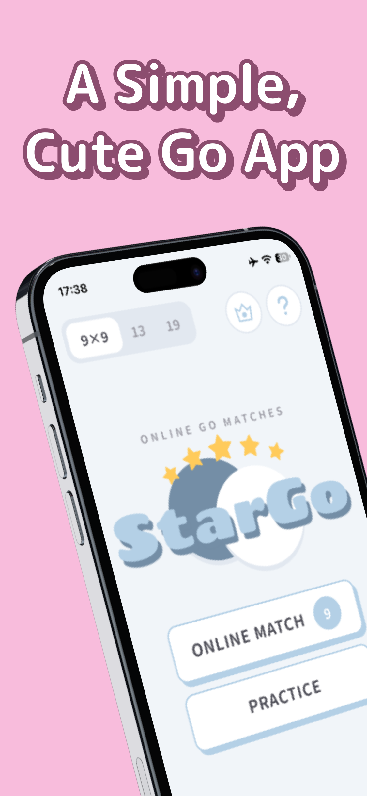
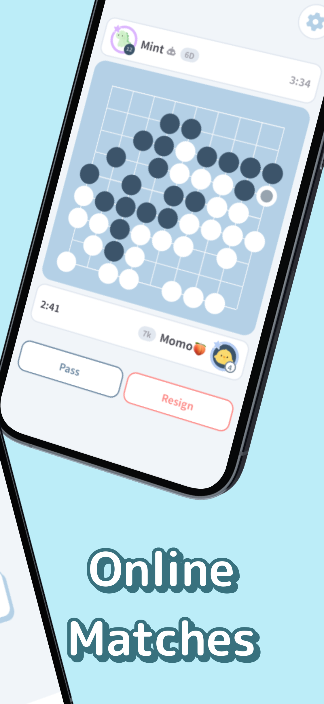
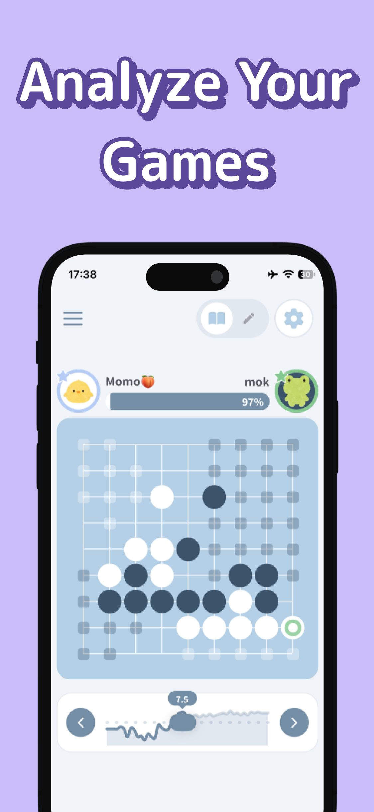
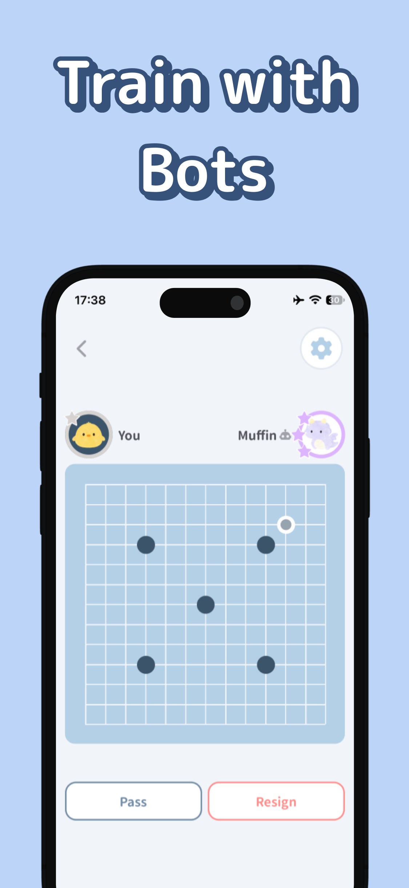

[中文](./README_zh.md) | [한국어](./README_ko.md) | [日本語](../README.md) | **English**

StarGo, a simple and cute Go app, is now available!

**■ Key Features**

- Real-time online matches
- Practice games against AI
- Post-game analysis and game replay
- Adorable design with a beginner-friendly UI

Whether you're brand new to Go or ready to test your skills, come play a game on StarGo!

- Web: https://hoshigo.app
- Android: https://play.google.com/store/apps/details?id=com.mokuyoubi.Hoshigo
- Mokuyoubi (Developer): https://mokuyoubi.org

<table>
  <tr>
    <td align="center">
      
    </td>
    <td align="center">
      
    </td>
    <td align="center">
      
    </td>
    <td align="center">
      
    </td>
  </tr>
</table>
